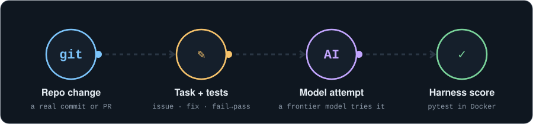
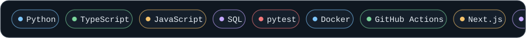
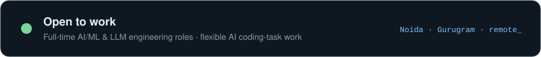

  

Software engineer based in Noida, working in Gurugram, India. I build **benchmark tasks and evaluation harnesses for training LLMs**, and review which tasks are correct, fair and hard enough to ship.

I like work where the hard part is judgment: finding the real change in a repository, writing a task around it that a model can't shortcut, and proving the answer with tests.

---

### What I work on

- **AI coding tasks.** I turn real repository changes into SWE-bench / SWE-Smith-style tasks: a clear problem statement, a reference fix, and tests that fail before the fix and pass after it.
- **Reasoning benchmarks.** I've worked on ARC-AGI abstract-reasoning tasks alongside the coding benchmarks.
- **Evaluation harnesses.** I've built harnesses across multiple projects that run and score tasks against models automatically, using pytest, Docker and GitHub Actions.

### Open source

- **[WooCommerce](https://github.com/woocommerce/woocommerce)**: I contribute pull requests and issue reports. [See my pull requests →](https://github.com/woocommerce/woocommerce/pulls?q=author%3Aabhiishek-sharma)

### A day at the desk

### Things I've built

| Project | What it is | Stack |
|---|---|---|
| **[Aspiron Systems](https://aspironsystems.com)** | Production website for an SAP training and consulting company (~3,200 monthly visitors). I built it end to end and ship ongoing features and fixes. | Next.js, React, TypeScript, Tailwind CSS |
| **QueryForge** | Natural-language-to-SQL pipeline with schema-aware prompts, plus a validation layer that blocks unsafe queries (DROP, DELETE, injection patterns) and auto-fixes wrong table and column names in model-written SQL. | Python, FastAPI, Ollama, SQLCoder, sqlparse, React |

### Tools I use

### Elsewhere

- Runner-up, **Smart India Hackathon 2023** (national level)
- B.Tech. in Computer Science, Galgotias University

### Contribution snake

<picture>
  <source media="(prefers-color-scheme: dark)" srcset="https://raw.githubusercontent.com/abhiishek-sharma/abhiishek-sharma/output/github-snake-dark.svg">
  
</picture>

<a href="https://www.linkedin.com/in/abhisheksharma04/">LinkedIn</a> · Abhisheksharmaa1404@gmail.com

